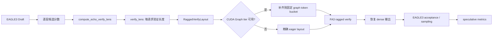

# ECHO 框架实现详设

## 1. 文档范围

本文基于 [sgl-project/sglang#33295](https://github.com/sgl-project/sglang/pull/33295) 整理 ECHO 在 SGLang 中的实现设计，重点说明模块划分、运行时数据流、FA3/CUDA Graph 集成、参数约束及验证方案。

ECHO（Elastic Speculative Decoding with Sparse Gating）作为 EAGLE3 的可选模式，通过 draft 阶段的置信度为每个请求动态决定 verify 长度，从而减少高置信请求的目标模型验证 token 数量。

ECHO 不新增独立的 speculative decoder，而是复用 EAGLE3 的 draft、verify、acceptance 和采样流程，在中间加入 ragged verify 布局与 FA3/CUDA Graph 适配。

## 2. 设计目标

1. 在 EAGLE3 top-k>1 场景下，为每个请求独立选择验证长度。
2. 将不同请求的验证 token 压缩到 ragged buffer，减少无效计算。
3. 保持现有 EAGLE3 verifier 的输入输出语义，降低集成风险。
4. 同时支持 CUDA Graph replay 和 eager fallback。
5. 对关键布局操作提供 Torch 实现和 Triton CUDA kernel。
6. 暴露验证窗口长度和 ECHO 运行时统计，支持性能分析。

## 3. 总体架构



核心执行顺序：

```text
Draft -> 计算 verify_lens -> 构造 ragged layout
      -> 选择 CUDA Graph tier
      -> 压缩输入 -> FA3 verify
      -> 恢复 dense 输出 -> EAGLE3 原有验收
```

## 4. 模块设计

### 4.1 参数和能力校验

相关文件：

- `python/sglang/srt/server_args.py`
- `python/sglang/srt/arg_groups/speculative_hook.py`

新增参数：

```bash
--speculative-echo-threshold 0.2
```

参数语义：

- 未设置：关闭 ECHO，保持普通 EAGLE3。
- 设置为 `[0, 1]` 内的有限浮点数：启用 ECHO。
- 阈值越高，越容易截短 verify window。

启用 ECHO 时必须满足：

- `--speculative-algorithm EAGLE3`
- decode attention backend 为 `fa3`
- `--disable-overlap-schedule`
- `--speculative-eagle-topk > 1`
- 单层 EAGLE3
- 固定 speculative 参数，关闭 adaptive speculative
- 关闭 rejection sampling、DP attention、LoRA
- `pp_size == 1`、`attn_cp_size == 1`、`dcp_size == 1`
- 不使用 MRoPE、混合 Mamba/GDN/linear attention、sliding-window attention
- 满足 gathered token buffer 拓扑要求

不满足条件时在 server argument validation 阶段直接报错，避免运行时进入未支持路径。

### 4.2 ECHO 验证长度计算

相关文件：

- `python/sglang/srt/speculative/eagle_utils.py`
- `python/sglang/srt/speculative/eagle_worker_v2.py`

核心接口：

```python
compute_echo_verify_lens(
    score_list,
    top_scores_index,
    threshold,
) -> torch.Tensor
```

输入：

- `score_list`：每个 draft layer 的候选分数。
- `top_scores_index`：EAGLE tree 中候选 token 的位置索引。
- `threshold`：ECHO 阈值。

算法：

1. 对每个 layer 的 score 做 flatten。
2. 计算该 layer 每个请求的最大分数。
3. 最大分数大于等于 threshold 的 layer 视为通过；NaN 在实现中也视为通过。
4. 对 layer 通过结果做前缀累乘，保证只有连续通过的 layer 可以贡献验证 token。
5. 根据通过 layer 的宽度得到 candidate cutoff。
6. 使用 `top_scores_index < cutoff` 统计每个请求的验证长度。
7. 最终长度限制为 `1 <= verify_len <= draft_token_num`。

输出：

```text
verify_lens: [batch_size]
```

ECHO 的核心特征是每个请求拥有独立的 verify length，而不是整个 batch 使用统一深度。

### 4.3 ECHO ragged kernel 与布局模块

相关文件：

- `python/sglang/kernels/ops/speculative/eagle_echo.py`

核心数据结构：

```python
@dataclass(frozen=True)
class EagleRaggedVerifyWindow:
    input_ids: torch.Tensor
    positions: torch.Tensor
    out_cache_loc: torch.Tensor
    query_layout: RaggedVerifyLayout
```

该模块包含四类职责。

#### 4.3.1 构造 padded query layout

`_build_eagle_query_layout` 将真实请求的 `verify_lens` 扩展到 graph batch slot：

- 真实请求保留原始长度；
- graph padding slot 初始长度为 0；
- 将剩余 graph token 分配给仍未达到 `draft_token_num` 的请求；
- 每个请求不会超过固定 tree 宽度；
- CUDA 使用 Triton kernel，CPU/eager 使用 Torch 实现。

该操作将真实 ragged layout 转换成满足 CUDA Graph 固定 shape 要求的 query layout。

#### 4.3.2 压缩 verify 输入

`_compact_eagle_verify_inputs` 将固定宽度 dense 输入压缩成连续 ragged buffer：

```text
dense:   [request0 tree][request1 tree][request2 tree]
compact: 只保留每个请求 verify_lens 范围内的 token
```

同时压缩：

- draft token
- position
- output cache location

CUDA 路径使用 `_compact_eagle_verify_inputs_kernel`；eager 路径使用 Torch 实现。

#### 4.3.3 恢复 verify 输出

`_restore_eagle_verify_output` 将 FA3 返回的 compact logits/hidden states 恢复成 EAGLE3 原有的 dense shape：

```text
[batch_size * draft_token_num, feature_size]
```

未参与验证的槽位填零，保证后续 EAGLE3 acceptance 逻辑无需改写。

#### 4.3.4 更新 retrieval metadata

`apply_eagle_retrieval_layout` 根据 `verify_lens`：

- 截断 `retrieve_index`；
- 清理超出窗口的 `retrieve_next_token`；
- 清理超出窗口的 `retrieve_next_sibling`；
- 将无效链接置为 `-1`。

### 4.4 EAGLE3 Worker 接入

相关文件：

- `python/sglang/srt/speculative/eagle_worker_v2.py`
- `python/sglang/srt/speculative/eagle_worker_common.py`
- `python/sglang/srt/speculative/multi_layer_eagle_worker_v2.py`
- `python/sglang/srt/speculative/standalone_worker_v2.py`

draft 返回值从四元组扩展为五元组：

```text
parent_list,
top_scores_index,
draft_tokens,
draft_probs,
verify_lens
```

路径行为：

- top-k=1 chain fast path：`verify_lens=None`；
- 普通固定深度 EAGLE3：`verify_lens=None`；
- ECHO top-k>1：计算并返回 `verify_lens`；
- multi-layer EAGLE：显式传 `None`；
- standalone worker：初始化 `echo_threshold=None`。

### 4.5 Ragged layout 和 Graph tier 选择

相关文件：

- `python/sglang/srt/speculative/eagle_worker_common.py`
- `python/sglang/srt/speculative/eagle_utils.py`

`build_eagle_verify_input` 的处理步骤：

1. 将 `verify_lens` 转换为设备上的 `int32`。
2. 对长度范围执行异步断言。
3. 同步 `verify_lens.sum()` 一个 scalar，避免同步完整向量。
4. 根据总 token 数选择 graph token tier。
5. 创建 `RaggedVerifyLayout`。
6. 截断 EAGLE retrieval metadata。
7. 将 layout 保存到 `EagleVerifyInput`。

Graph tier 选择规则：

```text
total_verify_tokens
    -> 向上取 capture token bucket
    -> bucket 必须存在
    -> graph slot capacity 必须覆盖 batch size
    -> 满足条件：使用 CUDA Graph
    -> 否则：使用精确 eager token 数
```

EAGLE3 的 graph tier 使用严格匹配：

```python
graph_num_tokens in capture_num_tokens
```

不能仅依据“低于最大 bucket”放行，否则 replay 时 query geometry 可能与 capture shape 不一致。

### 4.6 Verify preparation 和 eager fallback

相关文件：

- `python/sglang/srt/speculative/eagle_utils.py`
- `python/sglang/srt/speculative/eagle_info.py`

`EagleVerifyInput` 新增两个 layout 字段：

```python
ragged_verify_layout
ragged_query_layout
```

含义：

- `ragged_verify_layout`：真实请求的验证长度和 graph token bucket；
- `ragged_query_layout`：考虑 graph padding 后实际提交给 FA3 的 query geometry。

`eagle_prepare_for_verify`：

1. 保存原始 dense `out_cache_loc`。
2. 构造 `EagleRaggedVerifyWindow`。
3. 用 compact token、position、cache location 初始化 `ForwardBatch`。
4. 保存 query layout。
5. 如果 graph 不可用，则重新构造精确 eager layout，去除 graph padding。
6. 恢复 batch 自有的 dense cache-location 视图。

### 4.7 FA3 Attention Metadata

相关文件：

- `python/sglang/srt/layers/attention/flashattention_backend.py`

ECHO 需要为 FA3 构造：

- normal target-verify metadata；
- tree expand metadata；
- `cu_seqlens_q`；
- `cu_seqlens_k`；
- tree mask；
- KV page table；
- cache sequence length。

原有 top-k>1 metadata 以 batch size 为 key，ECHO 后扩展为：

```python
(batch_size, graph_num_tokens)
```

这样同一个 batch size 下不同 graph token bucket 可以独立 capture/replay。

`_build_target_verify_topk_expand_inputs` 负责：

1. 计算每个 query 所属 request；
2. 计算 query 在 request 内的偏移；
3. 从真实 EAGLE tree mask 中抽取有效 mask；
4. 对 graph padding row 使用安全 dummy mask；
5. 生成候选 KV page table；
6. 按 mask 对候选 KV 位置排序；
7. 生成 FA3 varlen attention 所需的 mask 和 page table。

padding row 只用于满足 graph 固定 shape，输出会在后续恢复/裁剪阶段被丢弃。

当前 ragged ECHO 路径不支持 sliding-window attention，代码会主动抛出 `NotImplementedError`。

### 4.8 CUDA Graph Runner

相关文件：

- `python/sglang/srt/model_executor/runner/decode_cuda_graph_runner.py`
- `python/sglang/srt/speculative/eagle_draft_cuda_graph_runner.py`

主要改动：

- EAGLE3 只有设置 ECHO threshold 才启用 ragged verify graph；
- EAGLE3 graph admission 使用严格 token tier 匹配；
- capture 时记录 `ragged_verify_layout`；
- replay 时根据 `ragged_query_layout` 更新 `cu_seqlens_q`；
- graph runner 输出携带 `verify_lens`；
- replay 输出只保留真实 batch，去除 padding slot。

## 5. 运行时数据流

### 5.1 Draft 阶段

```text
EAGLE3 draft model
    -> score_list
    -> top_scores_index
    -> draft_tokens
    -> compute_echo_verify_lens
    -> verify_lens
```

### 5.2 Verify 输入构造

```text
verify_lens
    -> RaggedVerifyLayout
    -> graph tier selection
    -> query layout padding
    -> dense input compaction
    -> ForwardBatch
```

### 5.3 FA3 Verify

```text
query layout
    -> cu_seqlens_q
    -> tree mask
    -> page table
    -> FA3 ragged target verify
```

### 5.4 输出恢复

```text
FA3 compact logits/hidden states
    -> scatter_eagle_verify_output
    -> dense EAGLE3 layout
    -> acceptance / bonus token / grammar mask
```

## 6. 运行时指标

ECHO 将验证窗口信息加入 speculative metadata，主要指标包括：

- `spec_verify_ct`：verify 次数；
- `spec_num_correct_drafts`：正确 draft 数；
- `spec_num_proposed_drafts`：提出的 draft 数；
- `spec_cap_lens_histogram`：验证窗口长度分布；
- acceptance length；
- acceptance rate；
- verify cap length；
- prompt、cached、completion token 数；
- 请求延迟和完整会话延迟；
- output throughput；
- conversations per second；
- exact output parity。

其中 `cap_lens`/`spec_cap_lens_histogram` 是评估 ECHO 是否真正缩短验证窗口的关键指标。

## 7. 参数和执行约束

推荐配置：

```bash
--speculative-algorithm EAGLE3 \
--attention-backend fa3 \
--disable-overlap-schedule \
--speculative-eagle-topk 8 \
--speculative-echo-threshold 0.2
```

不支持的组合会在启动阶段拒绝，而不是进入运行时降级。这样可以避免：

- FA3 metadata shape 不一致；
- CUDA Graph replay 使用错误 token bucket；
- sliding-window 或 hybrid attention 的 KV 布局不匹配；
- DP/PP/DCP/LoRA 等路径缺少对应的 ragged buffer 适配。

## 8. 测试设计

### 8.1 单元测试

覆盖：

- threshold 范围、NaN、无穷；
- 非 EAGLE3、非 FA3、overlap、top-k=1 等非法配置；
- MRoPE、混合 attention、并行拓扑约束；
- verify length 边界；
- retrieval metadata 截断；
- dense/ragged compaction；
- ragged 输出恢复；
- graph token bucket 选择；
- graph slot capacity；
- zero-length dummy slot；
- graph padding row；
- eager 精确布局；
- CUDA/Torch 结果一致性。

### 8.2 集成测试

新增 FA3 ECHO registered test：

- 固定 EAGLE3 steps/top-k/draft tokens；
- graph/eager 使用相同模型与请求；
- 比较文本、token IDs、finish reason；
- 比较 speculative counters；
- 覆盖 EOS 和 1～3 token early finish；
- 检查 `cap_lens` 与 verify count 一致。

### 8.3 MT-Bench 测试协议

- 使用 commit 固定的 FastChat MT-Bench 数据；
- 80 个问题、8 个类别、每类 10 个；
- 每个问题 2 轮；
- 冻结 turn-one assistant history；
- baseline 和 ECHO 仅改变 threshold；
- 每个配置运行三次，取 median；
- correctness 与 performance 分开执行；
- 默认 temperature=0、seed=0、`enable_thinking=False`。

## 9. PR 中报告的结果

| 模型 | 配置 | 中位吞吐 | 变化 |
|---|---|---:|---:|
| Qwen3-8B | EAGLE3 baseline | 640.56 tok/s | - |
| Qwen3-8B | ECHO, threshold=0.2 | 873.72 tok/s | +36.40% |
| Qwen3-235B-A22B | EAGLE3 baseline | 796.60 tok/s | - |
| Qwen3-235B-A22B | ECHO, threshold=0.05 | 841.87 tok/s | +5.68% |

PR 描述中的正确性结果：

- Qwen3-8B graph/eager：160/160 turn 精确匹配；
- Qwen3-235B-A22B graph/eager：64/64 turn 精确匹配；
- ECHO 专项 Triton kernel CUDA parity 通过；
- registered ECHO integration：3/3 通过。

性能测试允许 baseline 和 ECHO 因 BF16 batch/GEMM shape 差异产生合法输出差异；精确文本匹配主要用于 graph/eager correctness gate。

## 10. 设计评价与后续演进

### 优点

- ECHO 与 EAGLE3 主流程解耦，关闭时几乎不改变原路径；
- Torch/Triton 双路径便于测试和 CUDA 部署；
- graph token bucket 与 batch slot capacity 同时校验；
- compact 输入、restore 输出屏蔽了 ragged 布局对 verifier 的影响；
- 参数校验前置，避免运行时进入不完整适配路径；
- benchmark 固定数据集、冻结历史，结果可复现。

### 当前限制

- 仅支持单层 EAGLE3；
- 仅支持 FA3 和 top-k>1；
- 不支持 sliding-window、hybrid attention、DP/PP/DCP 等组合；
- graph tier 必须严格命中已 capture 的 token bucket；
- 每次 verify 仍需同步总 token 数来选择 graph tier；
- graph padding 会产生一定 dummy query 开销。

### 后续演进方向

1. 将 ragged verify 抽象为通用 speculative decoding 基础设施。
2. 扩展到 multi-layer EAGLE 和其他 speculative algorithm。
3. 支持更多 attention backend 与 sliding-window attention。
4. 减少 graph tier 选择中的 host-device 同步。
5. 根据历史 acceptance 分布自动调整 threshold。
6. 将 graph bucket、slot 利用率和 padding 开销纳入统一 profiler。

