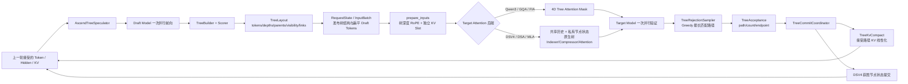

# vLLM-Ascend 动态树投机实现方案梳理

## 1. 文档范围与结论

本文依据以下材料整理：

- `动态树投机.pptx`，共 18 页，重点参考第 5～17 页。
- `vllm-ascend` 代码，提交 `9944a8445f05d707ec511797ab76233357b02de9`，提交主题为 `[Feature] Add tree speculation for qwen3 and dsv4`，提交时间为 2026-10-25。
- 下文所述文件及行号均以该提交为准。

**核心结论：当前代码已经实现“每轮动态生成树拓扑、静态配置树容量”的树投机推理。** Draft 模型仍通过一次并行前向提供多层候选，框架根据候选分数构树，Target 模型一次前向验证整棵树，Greedy 验证器选出最长匹配路径，再将接受路径上的 KV/状态整理为下一轮可连续使用的前缀。

需要特别区分两个“动态”概念：

1. **已实现的动态性**：每轮根据 Draft logits 重新生成树的节点、父子关系和可见性。
2. **尚未实现的动态性**：根据接受率、置信度、熵或硬件开销，在运行时调整 `budget`、`topk`、深度或各请求的节点数。PPT 中的 ECHO 属于这一类，当前代码尚未落地。

因此，当前实现更准确的描述是：**固定形状容量的动态拓扑树投机**，而不是完整的动态预算树投机。

---

## 2. 总体架构



主要组件职责如下。

| 组件                                                | 当前实现职责                                                          | 关键文件                                                          |
| ------------------------------------------------- | --------------------------------------------------------------- | ------------------------------------------------------------- |
| `AscendTreeSpeculator`                            | 加载 DFlash/DSpark Draft 后端；执行并行 Draft 前向；调用构树；保存并发布 `TreeLayout` | `vllm_ascend/worker/v2/spec_decode/tree/speculator.py`        |
| `TreeBuilder`                                     | 统一的逐层扩展、候选池管理和全局预算剪枝                                            | `.../tree/builder.py`                                         |
| `IndependentScorer / MarkovScorer / DominoScorer` | 将不同 Draft 模型的输出转换为统一的边分数和候选 Token                               | `.../tree/scoring.py`                                         |
| `TreeLayout`                                      | 保存扁平树、拓扑链接和祖先可见性                                                | `.../tree/layout.py`                                          |
| `prepare_tree_spec_pos_seq_lens`                  | 分离逻辑位置与物理 KV 位置                                                 | `vllm_ascend/worker/v2/input_batch.py:191-273`                |
| `AttentionMaskBuilder`                            | 为普通 FIA 后端生成树形 Mask                                             | `vllm_ascend/attention/attention_mask.py:192-305`             |
| DSV4 Tree Native Path                             | 构造原生树验证计划，管理共享历史、节点私有状态和 TopK                                   | `.../tree/chain_pack.py`、`vllm_ascend/attention/tree_spec.py` |
| `TreeRejectionSampler`                            | 对 Target argmax 与 Draft 树做自上而下 Greedy 匹配                        | `.../tree/rejection_sampler.py`                               |
| `TreeKvCompact`                                   | 将接受路径上的离散树节点 KV 搬到线性前缀位置                                        | `.../tree/kv_project.py`                                      |
| `TreeCommitCoordinator`                           | 统一处理普通 KV 压缩、DSV4 节点状态提交及下一轮 Query 整理                           | `.../tree/commit.py`                                          |
| `TreeFullGraphManager`                            | DSV4 Target、接受状态和 Query 整理的 FULL 图管理                            | `.../tree/full_graph.py`                                      |

---

## 3. 配置与形状约定

### 3.1 配置入口

树投机通过 `additional_config.tree_spec_config` 开启，Draft 深度仍由 vLLM 的 `speculative_config.num_speculative_tokens` 决定。

```json
{
  "speculative_config": {
    "method": "dflash",
    "model": "<draft-model-path>",
    "num_speculative_tokens": 4
  },
  "additional_config": {
    "tree_spec_config": {
      "enabled": true,
      "budget": 16,
      "topk": 4,
      "candidate_size": 64
    }
  }
}
```

`candidate_size` 仅用于带 Domino 修正头的 DFlash 候选短列表，不需要时应省略或设为 `null`。配置定义及校验位于 `vllm_ascend/ascend_config.py:1312-1358`。

### 3.2 三个核心维度

| 符号 | 配置来源 | 含义 |
|---|---|---|
| `K` | `speculative_config.num_speculative_tokens` | Draft 深度，即 Draft logits 的层数 |
| `B` | `tree_spec_config.budget` | 非根节点存储/验证容量，不包含 root |
| `W` | `min(topk, vocab_size, B)` | 每层实际保留的 frontier 宽度 |

约束：

- `K >= 1`、`B >= K`、`topk >= 1`。
- Target 验证 Query 容量通常为 `1 + B`，多出的 1 是 root。
- DSV4 DSpark 且 `topk=1` 时退化为链，Target Query 容量为 `1 + K`，不是 `1 + B`。
- `topk=1` 时走原生链式 Rejection Sampler，不进入树 Greedy 验证器。
- 当前每轮发布节点数为 `min(B, K × W)`，由主机侧形状直接确定，不读取设备上的 `tree_num_nodes` 做动态控制。

形状定义见 `vllm_ascend/worker/v2/spec_decode/tree/shape.py`。

### 3.3 后端选择

`init_speculator` 在 `tree_spec_config.enabled=true` 时：

- DFlash：创建 `AscendTreeSpeculator`。
- 符合树条件的 DSpark：创建 `AscendTreeSpeculator`。
- 其他投机方法：继续走各自原有 Speculator。

对应代码为 `vllm_ascend/worker/v2/spec_decode/__init__.py:28-112`。

---

## 4. 树的数据结构

### 4.1 节点编号

- `node_id=0`：root，即上一轮已经接受的 Token。
- `node_id=1..B`：Draft 非根节点。
- `slot=0..B-1`：非根节点在扁平数组中的下标，对应 `node_id=slot+1`。
- `parents`、`first_child`、`next_sibling` 中保存的是 `node_id`，不是 `slot`。

### 4.2 `TreeLayout` 字段

| 字段 | 形状 | 含义 |
|---|---|---|
| `tokens` | `[R, B]` | 每个非根节点的 Token ID；同时复用为扁平 Draft Tokens |
| `depths` | `[R, B]` | 节点深度，root 的直接子节点深度为 1 |
| `parents` | `[R, B]` | 父节点 `node_id`，root 为 0 |
| `num_nodes` | `[R]` | 有效非根节点数 |
| `visibility` | `[R, B, B]` | 非根节点之间的可见性；root 默认可见，不在矩阵中重复表示 |
| `first_child` | `[R, B+1]` | 每个节点的第一个子节点，无子节点为 -1 |
| `next_sibling` | `[R, B+1]` | 下一个兄弟节点，无兄弟为 -1 |

其中 `R` 为请求数。`visibility[i, j]=true` 表示节点 `i+1` 可以看见节点 `j+1`。矩阵包含节点自身，并通过继承父节点可见性表达完整祖先集合。

定义见 `vllm_ascend/worker/v2/spec_decode/tree/layout.py:6-51`。

### 4.3 拓扑生成

`finalize_tree_layout` 完成两件事：

1. 将全局剪枝后的 Token、深度和重映射后的父节点写入持久 Buffer。
2. 生成孩子/兄弟链接，并逐节点继承父节点的 `visibility`。

NPU Eager 路径优先使用 Triton；ACLGraph 捕获时使用 Torch 参考实现，避免捕获不支持的 Kernel。见 `layout.py:69-177`。

---

## 5. Draft 前向与构树方案

### 5.1 Draft 模型只执行一次并行前向

`AscendTreeSpeculator` 继承 DFlash Speculator，同时兼容 DSpark Draft。其关键设计是：

- Draft 模型一次并行前向产生 `[R, K, V]` 的 logits。
- 不按树节点逐个调用 Draft 模型。
- `propose()` 对上层仍返回扁平的非根 Token，保持原生 vLLM 接口。
- 完整树结构保存在 `speculator.tree`，随后复制到 `req_states`，下一轮 `prepare_inputs` 再挂到 `InputBatch`。

相关代码：

- `speculator.py:70-84`：类职责与接口约定。
- `speculator.py:478-616`：`propose` 主流程。
- `speculator.py:675-699`：计算 logits 并调用 `TreeBuilder.build`。
- `model_runner.py:446-455`：树结构写入 `RequestState`。
- `model_runner.py:1191-1200`：树结构挂载到 `InputBatch`。

### 5.2 统一的逐层扩展算法

当前 `TreeBuilder` 不是 PPT 中三个独立算法文件的简单集合，而是一个共享实现：

1. 初始化 root，路径分数为 0，frontier 只包含 root。
2. 对第 `d` 层，Scorer 为当前 frontier 的每个父节点生成候选边分数。
3. 新节点路径分数为：

   ```text
   path_score(child) = path_score(parent) + edge_log_prob(child)
   ```

4. 在当前层的候选中做全局 Top-W，形成新的 frontier。
5. 重复 `K` 层，得到最多 `K × W` 个节点的候选池。
6. 对整个候选池按以下优先级排序并保留前 `min(B, K × W)` 个节点：

   ```text
   priority = path_score - depth_penalty × depth
   ```

7. 保留原候选池节点 ID 的相对顺序，重映射父节点 ID，最后生成 `TreeLayout`。

实现位于 `vllm_ascend/worker/v2/spec_decode/tree/builder.py:135-234`。

由于边分数是非正的对数概率、深度惩罚非负，并使用稳定排序，实现以“祖先优先”保证最终保留集合具有前缀闭包，避免保留子节点却剪掉祖先。

### 5.3 三类 Scorer

| Scorer | 适用 Draft | 候选分数与状态修正 | 深度惩罚 |
|---|---|---|---|
| `IndependentScorer` | 无修正头的 DFlash | 各深度 logits 独立做 `log_softmax + Top-W`，不同父节点共享该层候选边 | `0.2`，全局剪枝偏好浅层节点 |
| `MarkovScorer` | DSpark | 在 logits 上加入 `markov_bias(markov_embed(frontier_token))`，再将 Draft 词表 ID 映射到 Target 词表 ID | `0` |
| `DominoScorer` | 带 Domino 修正头的 DFlash | 基础 Top-C 候选 + GRU 隐状态 + MLP 修正；逐节点更新 GRU 状态 | 继承 `0.2` |

`create_tree_builder` 根据 Draft 后端和模型修正头选择 Scorer，而不是通过 `tree_spec_config.method` 选择。旧的 `method/params` 配置已明确移除。

相关代码为 `scoring.py` 和 `builder.py:237-255`。

### 5.4 Greedy 链保留

环境开关 `VLLM_ASCEND_TREE_KEEP_GREEDY` 开启后，Builder 会确保完整 Greedy 链不被 Top-W 或全局预算剪枝丢弃，因此要求 `B >= K`。这用于避免树扩展破坏原有单链最佳路径。

### 5.5 与 PPT 构树设计的对应关系

| PPT 设计 | 当前代码情况 |
|---|---|
| `priority.py`：CPU heapq 最佳优先 | 未发现独立实现；当前为设备端逐层扩展与全局排序 |
| `beam.py`：逐层全局 Beam + Markov | 已由统一 `TreeBuilder + MarkovScorer` 覆盖主要语义 |
| `prefix.py`：DARTree 超树 + 前缀闭包裁剪 | 当前由统一候选池、全局剪枝及 DFlash Independent/Domino Scorer 覆盖，不存在独立 `prefix.py` |
| `dynamic_budget` | 当前 `TreeSpecConfig` 中不存在该选项 |

---

## 6. Target 输入：逻辑位置与物理 KV 位置分离

树中兄弟节点具有相同深度，但若直接把扁平下标当作 RoPE 位置，会把兄弟错误地看成一条链；若所有同深度节点共用一个 KV Slot，又会互相覆盖。当前实现使用两套位置：

```text
root:
  rope_pos = P
  slot_pos = P

非根节点（扁平块内偏移 block = 1..B）:
  rope_pos = P + tree_depths[block - 1]
  slot_pos = P + block
```

其中 `P=num_computed_tokens`。

- `positions`：用于 RoPE，表达逻辑深度。
- `slot_positions`：用于 KV Slot Mapping，保证每个树节点写入独立物理位置。
- `seq_lens = P + query_len`。
- Prefill 仍使用普通线性位置，不套用树深度。

实现位于 `vllm_ascend/worker/v2/input_batch.py:191-273`；Slot Mapping 选择位于 `model_runner.py:1298-1312`。

---

## 7. Target Attention 的两条实现路径

### 7.1 Qwen3 / GQA / 普通 FIA：显式树形 Mask

普通 FIA 可以接收自定义 Mask，因此整棵树仍作为一个请求的一组 Query 计算。

#### Mask 形状

```text
[B_batch, 1, Q_S, KV_S]
Q_S 至少为 1 + tree_budget
KV_S 按最大序列长度对齐到 128，或使用当前批次的对齐上界
```

Buffer 预分配并复用，保证 FULL Capture/Replay 时指针稳定。

#### Mask 语义

代码内部 `tree_visibility=True` 表示“可见”，而 FIA Bool Mask 中 `True` 表示“屏蔽”，所以写入时需要取反。

对于前缀长度 `P`：

1. 所有 Query 对 `0..P` 的历史 KV 与 root 可见，Mask 填 `False`。
2. root Query 不看任何 Draft 节点。
3. Draft Query 对 Draft 区域的 Mask 为 `~tree_visibility`，因此只能看自己及祖先，不能看兄弟或其他分支。
4. 无效/填充区域默认屏蔽。

优先通过 Triton 填充连续 Mask；不满足连续布局时使用 Torch 循环实现。见：

- `vllm_ascend/attention/attention_mask.py:239-305`
- `vllm_ascend/ops/triton/spec_decode/tree/attention_mask.py`
- `vllm_ascend/attention/tree_spec.py:157-166`

这条路径的主要额外成本是完整 Mask 的构建和传输。

### 7.2 DSV4 / DSA / MLA：共享历史与私有节点状态

DSV4 的压缩注意力和 Indexer 不能简单套用普通 4D Mask。当前代码已实现专门的原生树路径，而不是仅按 PPT 早期设想把树拆成多条链逐个调用原算子。

#### 验证计划

`model_runner` 根据 `parents/depths/num_nodes/query_start_loc` 调用 `set_tree_chain_layout`，再由 `chain_pack._build_plan` 生成：

- 每个 Query 的请求 ID、root 前缀和深度。
- 每个节点的祖先序列。
- 逻辑序列长度与压缩窗口信息。
- 物理原始 KV 的稀疏索引。
- 节点私有 KV/压缩状态及后续提交记录。

见 `model_runner.py:1202-1258` 和 `chain_pack.py:129-254`。

#### 原始 KV 与滑窗

`build_tree_ori_sparse_indices` 为每个节点构造：

- 逻辑滑窗内的共享历史 KV Slot。
- 该节点可见的祖先 Draft KV Slot。
- 按时间/祖先顺序排列的物理索引和 -1 填充。

逻辑位置使用树深度，物理 Draft Slot 使用 `P+node_id`，两者不会混淆。见 `vllm_ascend/attention/tree_spec.py:247-321`。

#### 原生树算子

本提交新增三类 DSV4 树算子及工程绑定：

| 算子 | 作用 |
|---|---|
| `quant_lightning_indexer_tree` | 树形 Indexer 与 TopK 选择 |
| `compressor_tree` / `compressor_tree_project` | 节点状态投影、按祖先聚合、归一化与 RoPE |
| `sparse_attn_sharedkv_tree` | 共享历史 KV + 树节点私有状态的压缩注意力 |

`compressor_tree` 当前支持 4/128 压缩比、128/512 head dim 和 64 维 RoPE；具体限制见 `csrc/attention/compressor_tree/README.md`。

`sparse_attn_sharedkv_tree` 的输入契约明确要求：一个树节点对应一个 TND Query，`seqused_kv` 是逻辑前缀长度加祖先数，原始 KV 历史共享，压缩尾部按祖先读取节点状态。见 `csrc/attention/sparse_attn_sharedkv_tree/README.md:11-41`。

#### 混合 Prefill/Decode

DSV4 混合批次使用 `TreeMixedBatch` 和独立的阶段 Metadata：

- Decode 阶段进入树验证计划。
- Prefill 阶段通过 `linear_prefill_scope` 暂时屏蔽树计划，继续走普通线性算子。
- 两阶段的 Buffer 和 Metadata 独立，避免相互覆盖。

---

## 8. Greedy 树验证

### 8.1 算法

`TreeRejectionSampler` 对 Target logits 先做 `argmax`，再从 root 开始逐层匹配：

1. 当前节点的 Target argmax 先作为一个输出 Token。
2. 遍历当前节点的孩子/兄弟链，寻找 Token ID 与 Target argmax 相同的孩子。
3. 找到则接受该 Draft 节点，记录其 `node_id`，移动到该节点继续。
4. 没有匹配孩子则停止；当前 Target argmax 即 bonus Token。
5. 对每个请求得到一条从 root 开始的连续接受路径，而不是跨分支拼接多个高分节点。

实现位于 `vllm_ascend/worker/v2/spec_decode/tree/rejection_sampler.py:14-101`，NPU 使用 Triton Kernel，其他设备使用无设备到主机读取的 Torch 参考实现。

### 8.2 输出

`TreeAcceptance` 包含：

| 字段 | 含义 |
|---|---|
| `path_node_ids` | 接受路径上的非根 `node_id`，未使用后缀为 -1 |
| `num_sampled` | 本轮输出 Token 数，包含 bonus |
| `num_accepted` | 接受的 Draft 节点数，不包含 bonus |
| `endpoint_node` | 接受路径终点；未接受 Draft 时为 root 0 |
| `active` | 当前请求是否参与有效树验证 |

通常有：

```text
num_sampled = num_accepted + 1   # active 请求
```

定义见 `vllm_ascend/worker/v2/spec_decode/tree/acceptance.py`。

### 8.3 边界处理

- 使用 `query_start_loc` 和 `cu_num_logits` 限制每个请求实际可验证的节点数。
- Chunked Prefill、无 logits 或无 Query 的请求标记为 inactive。
- `topk<=1` 直接调用上游 Rejection Sampler，保留链式随机拒绝采样语义。
- 当前树路径只实现 Greedy；PPT 中的 `magicmtp` 树验证未在该目录落地。仓库其他文件中的 MagicMTP 代码不能等同于树验证支持。

---

## 9. 接受路径提交与 KV Compact

### 9.1 普通 KV 的线性化

验证时，树节点 KV 写在 `P+node_id`；接受后，下一轮需要把接受路径转换成连续线性前缀。

对接受路径第 `d` 个节点（从 1 开始）：

```text
src_pos = P + path_node_ids[d - 1]
dst_pos = P + d
```

`TreeKvCompact` 对每个 KV Cache Group：

1. 根据 Block Table 将逻辑源/目标位置换算为物理 Block 与块内偏移。
2. 仅处理有效、active 且在范围内的路径节点。
3. 先 gather 到临时空间，再 scatter 到目标，避免源/目标重叠导致数据破坏。
4. 对共享底层存储的 Cache 做去重/绑定处理。
5. root 保持在 `P`，未接受分支不再成为后续可见前缀，其空间可由后续分配复用。

实现见 `vllm_ascend/worker/v2/spec_decode/tree/kv_project.py` 和 `transport.py`。

### 9.2 DSV4 节点状态提交

DSV4 除原始 KV 外，还包含压缩状态、Indexer TopK 和其他节点私有状态，提交顺序为：

1. `prepare_winner`：根据 `endpoint_node` 冻结获胜路径涉及的节点页，防止后续原 KV 搬运破坏源数据。
2. `TreeKvCompact.run`：整理原始 KV。
3. `commit_winner`：将冻结的获胜节点状态提交到正式历史。

对应代码为 `vllm_ascend/worker/v2/spec_decode/tree/commit.py:26-48`。

### 9.3 下一轮 Draft 输入整理

下一轮 `propose` 开始时，`TreeCommitCoordinator.compact_queries` 沿上一轮接受路径整理：

- Target last hidden。
- Aux hidden。
- Query 位置。

这样 Draft 模型读取的是实际接受路径的上下文，而不是扁平树中最后一个物理节点。见 `speculator.py:511-522` 和 `commit.py:50-66`。

---

## 10. ACLGraph / FULL 图设计

### 10.1 通用树路径

图优化拆分为多个相对独立的阶段：

- Draft Forward Graph：只包含 Draft 模型前向。
- Tree Finalize Graph：计算 Draft logits、构树并写入持久 `TreeLayout` Buffer。
- KV Compact Graph：按请求数捕获接受路径 KV 搬运。

Builder 在 Capture 前预分配候选池、父节点、路径分数、选择索引和 Scorer 状态空间。运行时使用持久 Buffer，未捕获的请求数回退到 Eager。

见 `speculator.py:632-754` 和 `kv_project.py:46-91`。

### 10.2 DSV4 FULL 图

`TreeFullGraphManager` 按以下 Key 懒捕获图：

```text
(batch descriptor, query boundaries, prefix capacity gear)
```

其图包括：

- `TreeTargetGraph`：树 Indexer、Compressor、Attention 和 Target Forward。
- `TreePostGraph`：冻结获胜节点、原始 KV Compact、节点状态提交。
- `TreeQueryGraph`：下一轮 Draft 所需 Hidden/Position 整理。

Target Sampling 和 Rejection 仍留在图外。Host 侧只选择形状档位、更新调度元数据和稳定输入，树拓扑与节点状态仍在设备端计算。

见 `vllm_ascend/worker/v2/spec_decode/tree/full_graph.py`。

---

## 11. 稳态执行链路

一次稳态树投机迭代可以概括为：

```text
1. 上一轮 propose 已发布扁平 Draft Tokens 和 TreeLayout。
2. prepare_inputs 展开 root + Draft Tokens，生成树深度 RoPE 与独立 KV Slot。
3. Attention Builder 准备 FIA Tree Mask，或 DSV4 原生树验证计划。
4. Target Model 一次前向计算 root 与所有 Draft 节点。
5. TreeRejectionSampler 用 Target argmax 找最长连续匹配路径，并产生 bonus。
6. postprocess_sampled 前执行 TreeCommitCoordinator.commit。
7. 普通后端压缩接受路径 KV；DSV4 额外冻结并提交获胜节点状态。
8. 更新 num_computed_tokens、last_sampled 等请求状态。
9. 下一次 propose 先沿接受路径整理 Hidden/Aux/Position。
10. Draft Model 并行前向，TreeBuilder 生成下一棵树。
```

模型主体不需要理解树拓扑；树语义主要由输入位置、Attention Metadata、验证器和提交协调器共同保证。

---

## 12. 当前限制与未完成项

### 12.1 动态预算尚未实现

当前代码具有以下固定形状约束：

- `budget/topk` 来自初始化配置。
- Draft 深度固定为 `num_speculative_tokens`。
- `propose` 收到与固定深度不同的 `num_speculative_tokens` 会直接报错：

  ```text
  Tree speculation requires a fixed draft depth; dynamic speculative token counts are not supported.
  ```

- 每轮选择节点数由 `K/W/B` 统一确定，没有按请求 Early Stop。
- 未发现 `DynamicTreePolicy`、ECHO 门控、接受率反馈调树或硬件收益成本模型。

`dynamic_spec_config` 是另一套动态投机长度配置，不能据此认为树预算已经动态化。

### 12.2 验证算法

- 树验证目前只有 Greedy argmax 匹配。
- 任意温度采样下的树级 MagicMTP/残差分布验证未在当前树模块中实现。

### 12.3 DSV4 图与并行约束

DSV4 DSpark 且 `topk>1` 时，当前实现要求：

- 非 Eager 模式下使用 `CUDAGraphMode.FULL`。
- `pipeline_parallel_size=1`。
- `prefill_context_parallel_size=1`。
- `decode_context_parallel_size=1`。
- 未集成 KV Transfer。

此外，DFlash Tree 需要完整 Draft logits，不支持 `use_local_argmax_reduction`。

### 12.4 原生算子与验证依赖

DSV4 树路径依赖新增 AscendC 算子及对应 Vendor/Binding。其 README 明确说明部分树测试和启动器维护在仓库外的 Validation 包中。本文只做静态代码梳理，未在 NPU 环境编译、运行或验证性能。

---

## 13. PPT 与当前代码差异汇总

| 模块 | PPT 中的描述 | 当前代码结论 |
|---|---|---|
| Speculator | `AscendTreeSpeculator` 返回扁平 Token，树由自身保存并写入 ReqState | 已实现 |
| TreeBuilder | Priority / Beam / Prefix 三种独立方案 | 已统一为一个 Builder，通过不同 Scorer 适配模型 |
| TreeRejectionSampler | Greedy / MagicMTP | 仅 Greedy 树验证已实现 |
| TreeKvCompact | 接受路径 KV 从树 Slot 搬到线性前缀 | 已实现，并有图捕获和 DSV4 提交流程 |
| Attention Mask | 每个节点只关注祖先 | FIA 已实现显式 4D Mask |
| DSV4 Attention | 早期考虑拆成链式 Draft 逐条计算 | 当前已提供原生共享历史/节点状态树算子与验证计划 |
| Dynamic Tree / ECHO | PPT 第 16 页标记 TODO | 仍未实现动态预算；当前只动态生成拓扑 |
| 置信度/接受率/熵/硬件反馈 | 第 16～17 页调研方向 | 未接入当前 TreeBuilder |

---

## 14. 后续实现 ECHO 动态树的切入点和约束

以下是基于当前代码结构得出的改造建议，不代表现有功能：

1. **策略输入**：在 `TreeRejectionSampler` 输出接受数，在 Scorer 处获得 Draft 置信度/熵，在运行时采集 Target 验证耗时。
2. **策略位置**：可新增独立 `DynamicTreePolicy`，由 `AscendTreeSpeculator` 在构树前查询，避免把调度策略塞进模型 Scorer。
3. **形状上限**：保留配置中的 `B/K/W` 作为图捕获最大容量，运行时只选择不超过上限的有效节点，避免每轮重新分配 Buffer。
4. **每请求有效节点数**：当前 `num_selected_nodes` 是全 Batch 统一 Host 整数；真正按请求动态预算需要让调度、Query 展开、Mask、Sampler 和 KV Compact 都遵守每请求 `num_nodes`，不能仅修改 Builder。
5. **图兼容**：FULL 图需要固定容量加设备端有效掩码，或按有限预算档位捕获；不能让设备侧置信度直接驱动 Host 侧任意形状变化。
6. **调度一致性**：扁平 Draft Token 发布和 `query_start_loc` 必须同步反映实际预算，否则 Target 验证行数与树结构会不一致。
7. **正确性基线**：动态策略只改变候选树，不应改变 Greedy/采样验证的输出分布语义；应覆盖单请求、混合 Batch、Prefill/Decode、短树、零接受和 FULL Replay。

---

## 15. 关键源码索引

以下路径均相对于 `vllm-ascend` 仓库根目录：

```text
vllm_ascend/ascend_config.py
vllm_ascend/worker/v2/spec_decode/__init__.py
vllm_ascend/worker/v2/spec_decode/tree/speculator.py
vllm_ascend/worker/v2/spec_decode/tree/builder.py
vllm_ascend/worker/v2/spec_decode/tree/scoring.py
vllm_ascend/worker/v2/spec_decode/tree/layout.py
vllm_ascend/worker/v2/spec_decode/tree/shape.py
vllm_ascend/worker/v2/spec_decode/tree/rejection_sampler.py
vllm_ascend/worker/v2/spec_decode/tree/acceptance.py
vllm_ascend/worker/v2/spec_decode/tree/kv_project.py
vllm_ascend/worker/v2/spec_decode/tree/commit.py
vllm_ascend/worker/v2/spec_decode/tree/chain_pack.py
vllm_ascend/worker/v2/spec_decode/tree/full_graph.py
vllm_ascend/worker/v2/spec_decode/tree/draft_tokens.py
vllm_ascend/worker/v2/input_batch.py
vllm_ascend/worker/v2/model_runner.py
vllm_ascend/worker/v2/states.py
vllm_ascend/attention/attention_mask.py
vllm_ascend/attention/tree_spec.py
vllm_ascend/attention/attention_v1.py
vllm_ascend/attention/dsa_v1.py
vllm_ascend/ops/triton/spec_decode/tree/
csrc/attention/quant_lightning_indexer_tree/
csrc/attention/compressor_tree/
csrc/attention/compressor_tree_project/
csrc/attention/sparse_attn_sharedkv_tree/
```
