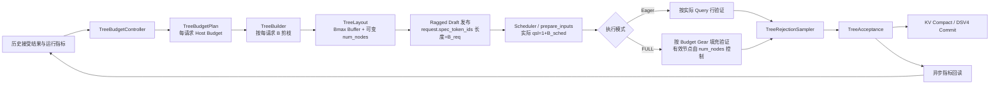

# 动态 Budget 树投机详细设计

## 1. 文档信息

- 目标项目：`vllm-ascend`
- 基线提交：`9944a8445f05d707ec511797ab76233357b02de9`
- 设计范围：Model Runner V2、DFlash/DSpark Tree Speculator、FIA 与 DSV4 树验证路径
- 设计状态：推荐方案，未实现
- 关联文档：`vllm-ascend动态树投机实现方案.md`

---

## 2. 背景与问题定义

当前树投机已经支持每轮根据 Draft logits 生成不同拓扑，但以下形状参数在初始化后固定：

- Draft 深度 `K = speculative_config.num_speculative_tokens`。
- 非根节点容量 `B = tree_spec_config.budget`。
- 每层宽度 `W = min(topk, vocab_size, B)`。
- 每请求发布节点数 `min(B, K × W)`，全 Batch 一致。
- Target Query 容量通常为 `1+B`。
- TreeBuilder、TreeLayout、Attention Mask 和 FULL 图均围绕固定容量设计。

固定 Budget 的问题是：不同请求、不同生成阶段和不同并发度下，最优候选节点数不同。预算过小可能降低接受长度，预算过大则增加 Draft 构树、Target 验证、Attention Mask、KV 写入及 Compact 开销。

### 2.1 设计目标

本设计希望同时获得：

1. **每请求动态 Budget**：同一 Batch 中不同请求可以发布不同数量的树节点。
2. **固定最大容量**：运行中不扩展 `TreeLayout` 和 Attention 的最大 Buffer。
3. **有界图数量**：FULL 图按有限档位复用，不按任意 Budget 组合无限捕获。
4. **无稳态阻塞同步**：预算更新不能引入每步 NPU→CPU `.item()` / `.cpu()` 等待。
5. **兼容现有验证与提交**：复用 Greedy Sampler、TreeAcceptance、TreeKvCompact 和 DSV4 节点提交。
6. **可回退**：关闭动态配置后恢复当前静态树行为。

### 2.2 首版非目标

首版不做：

- 动态 Draft 深度 `K`。
- 动态 `topk`。
- 每轮任意改变 Draft 模型 Query 数。
- MagicMTP 或随机树验证。
- 基于当前 Draft logits 的同步 Host 预算决策。
- 任意 Budget 值对应的无限 FULL Graph 捕获。
- 同时启用树动态 Budget 与现有链式 `enable_adaptive_verification`。

这些能力可以在后续阶段扩展，但不应与首版每请求动态 `B` 一起引入。

---

## 3. 推荐方案概述

采用：

> **最大容量固定 + 每请求 Budget 可变 + Target 按实际长度执行 + FULL 图按有限档位填充。**

首版只动态调整非根节点数 `B_req[r]`，保持 `K` 和最大 `topk` 不变。



### 3.1 为什么选择该方案

| 方案 | 优点 | 主要问题 | 结论 |
|---|---|---|---|
| 全 Batch 共享动态 Budget | 改动小，图形状简单 | 无法适应请求间难度差异 | 可作为降级模式，不作为最终形态 |
| 每请求任意 Budget、任意图形状 | 理论计算最省 | 图数量爆炸，调度与 KV 管理复杂 | 不推荐 |
| 固定 Bmax，仅设备端 Mask 无效节点 | 实现简单 | Target 仍支付 Bmax 计算，节省有限 | 仅适合 FULL 图填充，不能作为完整方案 |
| **每请求 Budget + 有限图档位** | 调度和验证都能使用实际预算，图数量可控 | 需要改造 Builder 和发布接口 | **推荐** |

---

## 4. 核心概念与不变量

### 4.1 预算维度

| 名称 | 含义 | 生命周期 |
|---|---|---|
| `K` | Draft 深度，首版固定 | 初始化 |
| `Bmax` | 非根节点 Buffer 最大容量，即当前 `tree_spec_config.budget` | 初始化 |
| `Wmax` | 最大 frontier 宽度，由 `topk/Bmax/vocab` 决定 | 初始化 |
| `Cmax` | 最大候选节点数，`min(Bmax,K×Wmax)`；动态 Budget 的可选上界 | 初始化 |
| `B_req[r]` | 控制器为请求 `r` 选择的下一轮预算 | 每若干轮更新 |
| `B_pub[r]` | 本轮 Builder 实际发布并由 Handler 写出的节点数 | 每轮 |
| `B_sched[r]` | Scheduler 本轮实际调度的 Draft 数，可能因输出长度截断小于 `B_pub` | 每轮 |
| `B_verify[r]` | 实际参与 Target 验证的节点数 | 每轮 |
| `Q_r` | Target Query 行数，`1+B_sched[r]` | 每轮 |
| `G` | FULL 图使用的 Query 填充档位 | 有限集合 |

正常稳态且没有输出长度截断时：

```text
B_req[r] = B_pub[r] = B_sched[r] = B_verify[r]
Q_r = 1 + B_req[r]
```

发生调度截断时，必须满足：

```text
B_verify[r] <= B_sched[r] <= B_pub[r] <= B_req[r] <= Cmax <= Bmax
```

树必须是拓扑前缀封闭的，因此截断后仍是一棵合法的树。

### 4.2 必须保持的不变量

1. `K <= B_req[r] <= Cmax <= Bmax`，确保至少保留完整 Greedy 链，同时不超过实际候选池容量。
2. `TreeLayout` 的物理 Buffer 形状始终为 `[R,Bmax,...]`。
3. `tree_num_nodes[r]` 等于本轮实际有效节点数，不再全 Batch 相同。
4. 非根节点 `slot < tree_num_nodes[r]` 才有效；无效后缀统一填充。
5. `parents` 指向的父节点必须有效，且父节点深度小于子节点。
6. `visibility` 对无效节点全为 `False`。
7. `num_draft_tokens_per_req[r]` 必须等于本轮调度树节点数。
8. `query_start_loc`、Target logits 行数、`TreeLayout.num_nodes` 和 Sampler 的验证上界必须一致。
9. 预算只改变候选集合，不改变 Greedy 验证语义。
10. Host 不得读取当前设备 `tree_num_nodes` 来决定本轮控制流。

---

## 5. 配置设计

建议在 `tree_spec_config` 内增加独立嵌套配置，避免与现有链式 `dynamic_spec_config` 混淆。

```json
{
  "speculative_config": {
    "method": "dflash",
    "model": "<draft-model-path>",
    "num_speculative_tokens": 4
  },
  "additional_config": {
    "tree_spec_config": {
      "enabled": true,
      "budget": 32,
      "topk": 8,
      "dynamic_budget": {
        "enabled": true,
        "policy": "acceptance",
        "initial_budget": 8,
        "budget_gears": [4, 8, 16, 32],
        "update_interval": 8,
        "window_size": 32,
        "grow_accept_len": 3.5,
        "shrink_accept_len": 1.5,
        "grow_zero_accept_rate": 0.05,
        "shrink_zero_accept_rate": 0.4,
        "cooldown_steps": 4,
        "max_batch_budget": 256,
        "max_graph_gears": 4
      }
    }
  }
}
```

### 5.1 字段说明

| 字段 | 建议默认值 | 说明 |
|---|---:|---|
| `enabled` | `false` | 默认保持静态树 |
| `policy` | `acceptance` | 首版接受度策略；第二阶段可选 `echo_pr`，后续扩展 `goodput` 或论文版 `echo` |
| `echo_threshold` | 必填（仅 `echo_pr`） | 当前轮逐层置信度截断阈值，范围 `[0,1]`；异常值按 6.7 节降级 |
| `initial_budget` | `min(Cmax,max(K,2K))` | 新请求初始预算 |
| `budget_gears` | 由 `K..Cmax` 生成 | 允许选择的离散预算，必须递增且每项 `>=K` |
| `update_interval` | `8` | 每多少 Decode 轮允许重新评估 |
| `window_size` | `32` | EWMA/滑窗的历史长度 |
| `grow_accept_len` | `K-0.5` | 扩预算所需的平均接受长度 |
| `shrink_accept_len` | `max(1,0.35K)` | 缩预算阈值 |
| `grow_zero_accept_rate` | `0.05` | 扩预算允许的零接受比例上界 |
| `shrink_zero_accept_rate` | `0.4` | 缩预算的零接受比例阈值 |
| `cooldown_steps` | `4` | 每次变更后的冻结期，防止振荡 |
| `max_batch_budget` | 调度上限推导值 | 限制 `sum(B_req)`，防止高并发验证过载 |
| `max_graph_gears` | `4` | FULL 图允许的最大 Budget 档位数 |

### 5.2 配置校验

在 AscendConfig 初始化阶段校验：

- `dynamic_budget` 仅在 `tree_spec_config.enabled=true` 时有效。
- `budget_gears` 非空、严格递增、去重。
- `K <= min_gear <= max_gear <= Cmax <= Bmax`，其中 `Cmax=min(Bmax,K×Wmax)`。
- `initial_budget` 必须属于档位，或初始化时向上取最近档位。
- `max_batch_budget >= R_active_min × K` 的可行条件在运行时检查。
- 首版若 `speculative_config.enable_adaptive_verification=true`，与树动态 Budget 互斥并给出明确报错。
- 首版异步调度未启用时，若 `scheduler_config.async_scheduling=true`，应拒绝启动或自动降级为静态树，不能静默走错形状。

---

## 6. 动态预算控制器

### 6.1 新增数据结构

建议新增 `vllm_ascend/worker/v2/spec_decode/tree/budget.py`：

```python
@dataclass(frozen=True)
class TreeBudgetPlan:
    depth: int
    max_budget: int
    budget_cpu: np.ndarray       # int32 [R]，Host 权威值
    budget_gpu: torch.Tensor     # int32 [R]，Builder 使用
    gear_ids: np.ndarray         # int16 [R]
    generation: int              # 防止异步旧计划误用

    @property
    def total_budget(self) -> int: ...

    def validate(self, req_count: int) -> None: ...
```

每请求状态：

```python
@dataclass
class TreeBudgetRequestState:
    current_budget: int
    pending_budget: int
    ewma_accept_len: float
    ewma_zero_accept: float
    rounds_since_update: int
    cooldown: int
    last_generation: int
```

控制器接口：

```python
class TreeBudgetController:
    def initial_plan(self, req_ids: list[str]) -> TreeBudgetPlan: ...

    def observe_async(
        self,
        req_ids: list[str],
        acceptance: TreeAcceptance,
        verified_nodes: torch.Tensor,
    ) -> None:
        """提交非阻塞 D2H；事件未完成时继续使用历史指标。"""

    def poll(self) -> None:
        """只 event.query()，不 wait；读取已完成的 pinned host 指标。"""

    def plan_next(
        self,
        req_ids: list[str],
        *,
        max_batch_budget: int,
        output_limit_cpu: np.ndarray | None,
    ) -> TreeBudgetPlan: ...
```

### 6.2 预算决策放在哪里

推荐由 **Model Runner / Tree Speculator 侧**产生下一轮 Budget，而不是让 Scheduler 独立推测树结构：

- Speculator 能直接获得 TreeAcceptance、树节点数和 Draft 统计。
- Handler 发布多少 Draft Token，Scheduler 下一步就按实际列表长度调度多少。
- 不需要在 SchedulerOutput 中新增一棵树专用结构。
- Scheduler 仍负责输出长度截断、Batch Token 上限和 KV 分配，不理解树拓扑。

Scheduler 侧只把 `len(request.spec_token_ids)` 当作该请求的调度 Budget，不直接运行接受度算法。

### 6.3 首版接受度策略

树的 `B` 是候选节点数，而接受路径长度最多为 `K`，因此**不能直接用 `num_accepted / B` 作为不同 Budget 间可比较的接受率**。预算增大时，该比值即使在接受长度不变的情况下也会下降。

首版使用与 `B` 无量纲绑定的指标：

```text
accept_len[r] = acceptance.num_accepted[r]              # 0..K
zero_accept[r] = acceptance.num_accepted[r] == 0
verified[r] = 本轮实际验证节点数                       # 仅用于统计和诊断
```

EWMA 更新：

```text
L_r ← α × accept_len + (1-α) × L_r
Z_r ← α × zero_accept + (1-α) × Z_r
α = 2 / (window_size + 1)
```

推荐状态机：

```text
若 cooldown > 0：
    保持当前 Budget
否则若发生内存/高并发压力：
    降一档
否则若 Z_r >= shrink_zero_accept_rate 或 L_r < shrink_accept_len：
    降一档
否则若 Z_r <= grow_zero_accept_rate
     且 L_r >= grow_accept_len
     且全局 Batch Budget 有余量：
    升一档
否则：
    保持
```

每次只变一档，并设置 `cooldown_steps`，避免预算振荡。

### 6.4 Batch 级预算分配

每请求独立升档之前，必须满足：

```text
sum_r B_candidate[r] <= max_batch_budget
```

推荐分配顺序：

1. 所有请求先保留最小档位，保证完整 Greedy 链。
2. 剩余预算按 `L_r` 高、`Z_r` 低、历史边际收益高优先分配。
3. 每请求最多升一档。
4. 预算不足时保持原档位，不阻塞整个 Batch。
5. 新请求使用 `initial_budget`，不继承已删除请求的状态。

首版的 `max_batch_budget` 是本地 Worker/DP Batch 约束，不做跨 DP 全局协调。

### 6.5 后续 Goodput 策略

第二阶段可扩展 `policy="goodput"`，使用：

```text
goodput = accepted_tokens / (T_draft + T_verify + T_compact)
```

注意：

- 目标不是最大化接受长度，而是最大化单位时间有效输出。
- Batch 级耗时不能直接解释为单请求耗时，应按 Batch Budget Gear 建立成本模型。
- 可按 `(R, total_budget, backend, graph_mode)` 聚合延迟 EWMA。
- 升档需要预期收益大于成本，并设置最小收益阈值和冷却期。
- 不建议首版直接引入复杂 Bandit/Roofline；先用接受度策略打通框架。

### 6.6 后续置信度策略

DFlash 最大 Softmax 概率、DSpark Confidence Head 可作为辅助信号，但它们只是接受概率代理，不等于 Target 接受率。

为避免同步：

- 当前轮置信度只在设备端计算统计量。
- 每 `update_interval` 轮提交一次异步 D2H。
- Host 只消费已经完成的上一次统计。
- 统计未就绪时沿用旧 Budget。
- 首版不做当前 logits 驱动当前 Budget 的同步决策。

### 6.7 第二阶段 `echo_pr`：当前轮逐层置信度截断

为弥补历史 EWMA 的响应滞后，第二阶段增加 `policy="echo_pr"`。该策略参考 SGLang PR #33295 的工程实现，但不把它等同于论文完整 ECHO。

#### 策略语义

TreeBuilder 在各深度已经维护累计路径分数。将每层最大累计路径概率作为当前请求在该层的置信度：

```text
c[r,d] = max_j path_probability[r,d,j]
pass[r,d] = finite(c[r,d]) and c[r,d] >= threshold
```

连续通过前缀决定该请求的有效 Budget。第 `d` 层失败后，后续层不再进入本请求验证集合：

```text
active[r,0] = true
active[r,d] = active[r,d-1] and pass[r,d-1]
B_verify[r] = 连续 active 层对应的候选拓扑前缀节点数
```

`echo_pr` 只截断当前候选树，不主动加宽、加深，也不要求离线校准。它与论文完整 ECHO 的区别必须写入配置文档：

- 每层都进行判断，不是 AUC 选择的稀疏 Sweet Spot。
- 首版共享一个 Threshold，不是逐层 `τ_d`。
- 没有全局深度优先和剩余预算加宽。
- 没有跨请求主动转移预算。
- 没有严格的 `ΣB_verify[r]=K_max` 全局 Super-Tree 调度。

因此，`echo_pr` 是“当前轮逐层置信度截断策略”，不是论文两阶段 ECHO 的完整复现。

#### 与 Builder 的结合

`echo_pr` 可以与 BudgetPlan 组合为两层限制：

```text
B_effective[r] = min(
  BudgetPlan.budget_gpu[r],
  当前轮置信度连续通过前缀对应的节点数
)
```

其中：

- `BudgetPlan` 仍负责最大发布容量、Scheduler 上限和图档位约束。
- 当前轮门控只进一步缩短有效树，不能超过原计划 Budget。
- Parent、Visibility 和链接仍按 `B_effective` 做前缀截断，不重新构树。
- Sampler 和 KV Compact 只处理实际验证及接受节点。

首版 `echo_pr` 先支持 Eager + FIA，验证当前轮策略收益后再接入 FULL。

#### 异常值与回退

不采用 PR 中 `NaN` 直接通过门控的 fail-open 行为。任何 `NaN/Inf` 或非有限路径分数应触发明确降级：

- 默认将当前请求降级为本轮静态 Budget，不执行置信度截断；同时记录 `tree_echo_invalid_confidence_total`。
- 若模型连续出现异常，自动退回 `policy="acceptance"` 或静态树并输出一次告警。
- 禁止将异常置信度解释为高置信度并继续扩树。

#### 适用边界

- 与 `keep_greedy` 的完整 K 链保护同时启用时，门控不得破坏 Greedy 链；首版要求二选一，推荐 `echo_pr` 下关闭完整 K 链保护。
- 不改变 Draft 深度 K 和最大 topk，不减少固定 Draft Forward 次数。
- 最大候选池、Top-B 选择及 Bmax Buffer 仍保留，主要收益来自 Target Verify 和有效 Layout 缩短。
- 不允许为了复用旧 Sampler 而默认恢复完整 Dense Logits；优先沿用本详设的 Ragged Sampler。

---

## 7. TreeBuilder 改造

### 7.1 当前限制

`TreeBuilder.build` 当前使用：

```python
num_nodes = min(self.budget, state.num_nodes)  # 全 Batch Host 标量
kept = priority.argsort(...)[:, :num_nodes]
self.num_selected_nodes = num_nodes
```

`TreeDraftTokensHandler` 也依赖这个 Host 标量发布二维 Token 块。

### 7.2 目标行为

Builder 接收 `TreeBudgetPlan`：

```python
tree_builder.build(
    draft_logits,
    layout,
    root_token_ids=root_token_ids,
    draft_hidden=draft_hidden,
    budget_plan=plan,
    graph_safe=graph_safe,
)
```

要求：

- Draft 前向和 `K/Wmax` 扩展过程保持固定，兼容图捕获。
- 全局优先级排序仍按最大候选池执行。
- 每请求保留排序结果中的前 `B_req[r]` 个节点。
- 按原候选池顺序压缩节点，并分别重映射每个请求的 parent。
- `num_nodes` 直接写为设备侧 `budget_gpu` 与实际候选数的逐请求最小值。
- Handler 使用 Host `budget_cpu` 发布，不读取设备 `num_nodes`。

### 7.3 每请求剪枝算法

设排序后第 `r` 行第 `j` 个候选的原始位置为 `kept[r,j]`，最大保留 `Bmax`：

```text
rank[r,j] = j
keep[r,j] = rank[r,j] < B_req[r]
```

由于当前稳定排序和非正路径分数保证了任意排序前缀的祖先闭包，每请求取不同前缀仍保持合法树。

随后：

1. 按 `keep` 过滤每个请求的候选。
2. 按原候选池 ID 顺序重排有效节点。
3. `new_id = cumsum(keep)`，得到每请求独立的新节点编号。
4. 用 `old_to_new[parent]` 重映射父节点。
5. 无效后缀写：

   ```text
   tokens=-1
   depths=0
   parents=-1
   first_child=-1
   next_sibling=-1
   visibility=False
   ```

### 7.4 Greedy 链约束

开启 `VLLM_ASCEND_TREE_KEEP_GREEDY` 时：

- 每请求最小 Budget 必须 `>=K`。
- Greedy 链的优先级保护逻辑保持现状。
- 动态降档不能低于 `K`，否则完整 Greedy 链无法保留。

### 7.5 Kernel 改造

`finalize_tree_layout` 和 Triton Kernel 需要从标量 `num_nodes` 改为：

- Host 最大循环/Kernel 容量 `Bmax`。
- Device 每请求有效数量 `budget_gpu[R]`。

孩子/兄弟链接及 Visibility 生成只处理有效 Slot，避免无效后缀进入遍历链。

---

## 8. Draft 发布与 Scheduler 调度

### 8.1 利用现有 Ragged Draft 能力

当前 SchedulerOutput 已使用：

```python
scheduled_spec_decode_tokens: dict[str, list[int]]
```

Model Runner 也已经计算：

```python
num_draft_tokens_per_req = [len(draft_tokens.get(req_id, ())) ...]
query_start_loc = cumsum(num_scheduled_tokens)
```

因此，同步调度下不需要把树预算塞进一个全局 `num_spec_tokens_to_schedule` 标量。**每个请求的 Draft 列表长度就是 Budget。**

### 8.2 TreeDraftTokensHandler 改造

当前实现按统一 `num_selected_nodes` 取二维切片，需要改为 Ragged 发布：

```text
对请求 r：
  b = plan.budget_cpu[r]
  发布 req_states.draft_tokens[req_state_idx, :b]
  request.spec_token_ids 长度 = b
```

实现要求：

- 不调用只支持统一宽度的原有二维发布逻辑。
- 尽量使用一次扁平 D2H 和 Host Offset 切分，避免每请求单独同步拷贝。
- 发布前校验 `b` 属于计划、不超过 `Bmax` 且不小于 `K`。
- 请求新增、删除或复用 Slot 时清理旧 Budget 和旧树后缀。
- `tree_num_nodes` 的设备值与 Host 发布值只做断言/调试校验，不在稳态读取。

如果上游 `DraftTokensHandler` 无法被安全复用，应在本类中完整实现 Ragged 发布，或通过 Ascend Patch 增加上游扩展点，避免影响链式投机。

### 8.3 调度截断

输出长度或 Batch 限制可能导致：

```text
B_sched[r] < B_pub[r]
```

框架无需重新构树，但必须保证：

- 调度只截取 `request.spec_token_ids` 的拓扑前缀。
- `query_start_loc` 使用截断后的长度。
- `TreeLayout.verified_node_counts` 继续取 `num_nodes/query_rows/logit_rows` 最小值。
- Sampler 不访问被截断的孩子。
- KV Compact 只处理实际接受路径。

### 8.4 Scheduler Patch 改造

`patch_spec_decode_stats.py` 当前通过临时修改全局 `scheduler.num_spec_tokens` 支持树验证宽度。动态 Budget 后应调整为：

- 按本 Batch 最大的实际 Draft 列表长度确定必要的调度/填充上限。
- 不再假设所有请求都使用同一个 `tree_spec_config.budget`。
- 保持 `output.num_spec_tokens_to_schedule` 的链式语义，不用它表达 Ragged Tree Budget。
- 异步 Placeholder 必须为每请求独立长度；首版不支持时明确拒绝，而不是继续使用固定 K Placeholder。

`recompute_scheduler.py`、`dyntra_lb_scheduler.py`、`scheduler_profiling_chunk.py` 需要审计：

- `request.spec_token_ids` 的截断是否保持前缀。
- `num_spec_tokens` 相关 Padding 是否错误覆盖 Ragged 长度。
- Batch Token/KV 上限是否按实际列表长度计算；若仍按 Bmax 保守预留，功能可运行但需在文档标明资源节省受限。

---

## 9. Prepare Inputs 与 Attention 改造

### 9.1 Position 与 Slot

`prepare_tree_spec_pos_seq_lens` 已按每个请求自己的 `query_len` 工作，基本可复用：

```text
rope_pos = P + tree_depth
slot_pos = P + query_offset
seq_len = P + query_len
```

需要新增断言：

```text
query_len - 1 <= tree_num_nodes[req]
query_len - 1 == 本轮实际调度 Draft 数
```

无效后缀不能参与 Slot Mapping。

### 9.2 FIA Tree Mask

`AttentionMaskBuilder` 改造点：

- 最大 Buffer 仍为 `[B_batch,1,1+Bmax,KVmax]`。
- 每请求实际 Query 行数使用 `Q_r`，不再统一 `1+Bmax`。
- `prev_kv_len = seq_len[r] - Q_r`。
- Draft Mask 只填 `tree_num_nodes[r]` 个有效节点。
- 无效节点及 Padding 区域保持屏蔽。
- `actual_seq_lengths_q` 使用每请求实际 `Q_r`。
- FULL Capture 时用最大档位 Mask，Replay 时用实际 Visibility/num_nodes 更新有效区域。

`tree_query_len()` 和 `tree_decode_threshold()` 应明确只返回**最大容量/图捕获阈值**，不能再作为所有请求的实际 Query 长度。

### 9.3 DSV4 验证计划

`chain_pack._build_plan` 已有按 `qsl` 和 `num_nodes` 限制节点的逻辑，可在此基础上改造：

- `qsl_cpu` 支持每个请求不同的 `Q_r`。
- `counts` 来自每请求 `tree_num_nodes`。
- `build_ancestors` 继续按实际有效节点生成祖先序列。
- Padded Query 行的 `visible=false`，不生成有效节点状态。
- Host Block Table Snapshot 不变。
- Mixed Batch 首版继续 Eager，避免同时改变阶段拆分与图档位。

### 9.4 Sampler 与 KV Compact

`TreeRejectionSampler` 的 `verified_node_counts` 已按实际 Query/logit 行数截断，改造较小：

- 确认 `num_nodes` 可为每请求不同值。
- `path_node_ids` 仍以固定最大深度 `K` 为宽度。
- 无效请求和截断请求保持 inactive/有限验证语义。

`TreeKvCompact` 不需要随 B 改变路径数组宽度，因为接受路径长度仍受 K 限制：

- `path_node_ids` 的 `-1` 后缀继续表示无搬运。
- `src_pos/dst_pos` 公式不变。
- 图只按请求数捕获，不按 Budget 捕获。
- 未接受/未验证节点均不进入正式历史。

---

## 10. FULL Graph 设计

### 10.1 图档位

定义有限的 Query Gear：

```text
Qgear[g] = 1 + budget_gears[g]
```

运行时：

```text
Q_pad[r] = 不小于 Q_r 的最小 Qgear
```

首版建议同一 Batch 使用一个共同图档位：

```text
Q_batch_gear = max_r Q_pad[r]
num_tokens_padded = R_padded × Q_batch_gear
```

实际有效行仍由 `qsl/num_nodes/active` 控制。

共同档位会增加一些 Padding 计算，但能把图形状控制在有限集合内。后续可评估按 Budget 分组执行，但首版不拆分 Batch。

### 10.2 Tree Finalize Graph

Tree Finalize 不必按 Budget 捕获：

- `K/Wmax/Bmax` 固定。
- `budget_gpu` 是持久输入 Buffer。
- Replay 前只更新 Budget 和 Draft logits。
- 图仍按 `num_reqs` 组织。
- 每请求有效节点数由设备 Mask 和 `num_nodes` 决定。

### 10.3 FIA Target Graph

复用现有 Adaptive Verification 的“调度上限 + 实际 Query 重分配”思路，但树实现独立：

- Capture 使用最大 `Q_batch_gear`。
- Replay 更新实际 `query_start_loc`、Visibility 和 `num_nodes`。
- Mask Buffer 指针固定。
- Padding 行不产生有效 logits 或 KV 写入。

### 10.4 DSV4 FULL Graph

当前 `TreeFullGraphManager` 的 Key 包含精确 `qsl_cpu`：

```python
key = (desc, tuple(layout["qsl_cpu"]), capacity)
```

动态 Budget 下该 Key 会造成图数量膨胀，应改为：

```text
key = (
  padded_batch_desc,
  Q_batch_gear,
  prefix_capacity_gear,
  mixed_mode,          # 首版 mixed 仍 Eager
)
```

`qsl_cpu` 不再作为图身份，而是每次 Replay 更新的输入。需要同时做到：

- Plan 的 `n` 使用 Padded Query 行数。
- `counts` 和 `visible` 区分有效节点与 Padding。
- `node_records` 不记录 Padding 节点。
- Winner 与 Commit 只处理 active 请求和有效路径。
- `GraphMetadata.update` 不因实际 qsl 形状变化而失败，所有捕获张量按 Gear 固定形状。
- 未达到已捕获 Gear 的 Batch 可向上填充；超过最大 Gear 回退 Eager或报错，建议运行期回退 Eager并记录指标。

### 10.5 图数量与内存控制

建议：

- 预算档位最多 `max_graph_gears`。
- 按 `(R_gear,Q_gear,prefix_capacity_gear)` 统计图数量。
- 为 Target、Post、Query 图分别记录 Capture/Replay/Workspace。
- 达到图内存上限后不再捕获新 Gear，回退最近已捕获 Gear 或 Eager。
- 对 Gear 命中率、Padding 比例和 Eager 回退率增加指标。

### 10.6 `echo_pr` 与 FULL 图的三种同步取舍

`echo_pr` 的当前轮 `verify_lens` 在设备端产生。若 Host 希望按真实 `sum(verify_lens)` 选择最小图档位，就必须获得该标量。以下三种模式不能同时实现“当前轮动态决策、最小 Padding、完全无同步”，必须按场景选择。

| 模式 | 图档位决策 | Host 同步 | Padding/计算 | 推荐用途 |
|---|---|---:|---:|---|
| A：精确 Gear | 每轮读取 `sum(verify_lens)`，向上选最小已捕获 Gear | 每轮一次标量 D2H | 最小 | 性能对照和首轮实现，验证同步成本是否低于节省收益 |
| B：固定最大 Gear | 不读取当前总数，始终使用 `Q_batch_gear_max` | 无当前轮同步 | 最大 | 验证 FULL 正确性，或同步成本明显高的后端 |
| C：预测 Gear | 根据上一轮 Budget/接受反馈提前选择 Gear，当前设备只更新有效节点 | 无当前轮同步 | 中等且可能不合适 | 有稳定历史规律的负载；必须支持向上回退或 Eager |

补充规则：

- 模式 A 每轮最多读取一次标量，不允许逐请求 `.item()` 或读取完整 `verify_lens` 到 Host。
- 模式 B 应使用有限最大档位，而不是无上限 Bmax 全量验证；Padding 行仍须满足无 Logits、无 KV 写入、无 Winner。
- 模式 C 若实际 `verify_lens` 超过预测 Gear，不能静默截断，应选择更大 Gear 重放、Eager 回退或使用预先约定的最大 Gear。
- Eager 路径不需要为图选档读取总数：`qo_indptr` 和有效节点可留在设备上，容量使用已知上界；因此 `echo_pr` 首版优先 Eager，可先避免该标量同步。
- 任何模式都不默认恢复 Dense Logits。若短期兼容必须恢复，应单独测量恢复 Kernel 和大词表 Buffer 成本。

推荐实施顺序：先在 Eager 验证策略，再以模式 A 建立 FULL 性能基线，最后用数据决定生产环境采用 A、B 或 C，不预先承诺其中一种总是最优。

---

## 11. 异步反馈与并发一致性

### 11.1 禁止稳态阻塞读取

不得在每轮执行：

```python
budget = int(device_budget.item())
counts = acceptance.num_accepted.cpu()
```

该禁令适用于首版接受度反馈和 BudgetPlan 热路径。`echo_pr` 若显式选择 10.6 的模式 A，允许每轮仅一次 `sum(verify_lens)` 标量同步用于 FULL 图选档，但必须以性能测量证明其收益；模式 B/C 和 Eager 不应携带该同步。

推荐机制：

1. 为接受长度、零接受、验证节点数分配 pinned Host Buffer。
2. 在验证完成后发起异步 D2H，并记录 NPU Event。
3. 下次预算更新只调用 `event.query()`。
4. 事件未完成则不读取，继续旧计划。
5. Host 计划只使用已完成的 `generation`。
6. Buffer 复用前必须确认旧 H2D/D2H 已完成。

`worker/v1/spec_decode/utils.py` 中现有动态链实现包含预算更新点的 `.item()` 同步，可借鉴其生存概率思路，但不应直接复用其同步方式或链式 Budget 语义。

### 11.2 请求集合变化

每份计划绑定：

```text
generation + req_ids + request_slot_mapping
```

以下情况必须重建计划：

- 新请求加入。
- 请求完成或 Slot 被复用。
- Batch 顺序改变导致 `idx_mapping` 改变。
- Scheduler 对 Draft 做输出长度截断。
- 异步调度返回旧轮次结果。

不能用旧 `budget_gpu` 盲目写入新请求。

### 11.3 TP / PP / DP

- TP：同一请求的 Budget 必须在各 Rank 一致，计划由约定 Rank 产生并广播，其他 Rank 不独立运行策略。
- PP：只有最后 Rank 拥有 Sampler/Speculator 时，需要将 BudgetPlan 和树元数据传给其他 Rank；沿用现有 Spec PP 传输机制。
- DP：不同 DP Rank 的请求集合可独立决策，`max_batch_budget` 首版为本地约束。
- DSV4 当前 `PP/PCP/DCP=1` 限制不变。
- KV Transfer 与 DSV4 Tree 现有限制不变，不在本设计中扩张。

### 11.4 Async Scheduling

首版建议只支持同步调度，因为当前异步路径仍保留 K 宽 Placeholder。

后续支持时需要：

- 每请求独立 Placeholder 长度。
- `pending_budget` 与 `current_budget` 分离。
- 预算计划关联 Generation，旧结果只能推进与其匹配的请求状态。
- Scheduler 在结果未返回前不得假设新一轮 Budget 已生效。
- 对 Placeholder 被截断、请求抢占和结果乱序增加测试。

---

## 12. 关键文件改动清单

以下路径均相对于 `vllm-ascend` 根目录。

### 12.1 新增文件

| 文件 | 内容 |
|---|---|
| `vllm_ascend/worker/v2/spec_decode/tree/budget.py` | `TreeBudgetPlan`、请求状态、控制器、档位分配、异步反馈 Generation |
| `vllm_ascend/worker/v2/spec_decode/tree/gating.py` | 第二阶段 `echo_pr` 逐层累计路径置信度、连续通过前缀、异常降级和有效节点计算 |
| `tests/ut/worker/v2/spec_decode/tree/test_budget.py` | 策略、档位、Batch 上限、冷却、请求生命周期测试 |
| `tests/ut/worker/v2/spec_decode/tree/test_dynamic_builder.py` | 每请求剪枝、父节点重映射、Greedy 链、Padding 测试 |
| `tests/ut/worker/v2/spec_decode/tree/test_dynamic_verify.py` | Ragged Query、Mask、Sampler、KV Compact 测试 |
| `tests/ut/worker/v2/spec_decode/tree/test_dynamic_graph.py` | Gear 选择、图 Key、Padding、Replay 与回退测试 |
| `tests/ut/worker/v2/spec_decode/tree/test_gating.py` | `echo_pr` 连续截断、阈值、NaN/Inf 降级，以及 FULL A/B/C 三种同步模式 |

### 12.2 配置与状态

| 文件 | 改动 |
|---|---|
| `vllm_ascend/ascend_config.py` | 新增 `DynamicTreeBudgetConfig`；校验档位、互斥关系、Async 限制 |
| `vllm_ascend/worker/v2/states.py` | 保存每请求 Budget、Generation 和 Host 反馈状态；新增请求时初始化 |
| `vllm_ascend/worker/v2/input_batch.py` | 增加 Budget/有效节点元数据；校验 Ragged Query；复用位置 Kernel |
| `vllm_ascend/worker/v2/spec_decode/tree/shape.py` | 分离 `Bmax`、实际 Budget、Target 最大容量与实际 Q；去除单一标量假设 |

### 12.3 构树与发布

| 文件 | 改动 |
|---|---|
| `.../tree/speculator.py` | 持有 BudgetController；生成/更新 Plan；移除固定深度以外的标量 Budget 假设；调用 Ragged Builder |
| `.../tree/builder.py` | `build` 接收 BudgetPlan；每请求剪枝；设备侧有效数量；不再发布统一 `num_selected_nodes` |
| `.../tree/layout.py` | `finalize_tree_layout` 支持每请求节点数、Parent 重映射和无效后缀 |
| `.../tree/draft_tokens.py` | Ragged Draft 发布；避免统一二维切片；处理 Host Offset 和请求生命周期 |
| `vllm_ascend/ops/triton/spec_decode/tree/finalize_layout.py` | Kernel 支持每请求有效 Slot、链接和 Visibility |
| `vllm_ascend/ops/triton/spec_decode/tree/expand.py` | 原则上保持固定 K/W 扩展；只需审计动态 Budget 下的 Capacity 假设 |

其中 `.../tree/` 表示 `vllm_ascend/worker/v2/spec_decode/tree/`。

### 12.4 调度与 Model Runner

| 文件 | 改动 |
|---|---|
| `vllm_ascend/worker/v2/model_runner.py` | 创建/驱动 Controller；读取实际 Draft 长度；维护 Ragged qsl；更新反馈；处理请求映射 |
| `vllm_ascend/patch/platform/patch_spec_decode_stats.py` | 将固定全局 Tree Verify Width 改为 Batch 实际上限；保留链式统计语义 |
| `vllm_ascend/core/recompute_scheduler.py` | 审计/修改 Ragged Draft 截断、Padding 和 Token/KV Budget 计算 |
| `vllm_ascend/core/dyntra_lb_scheduler.py` | 同上，确保负载均衡调度不恢复统一 Budget |
| `vllm_ascend/core/scheduler_profiling_chunk.py` | 同上，确保 Profiling/Chunk 路径一致 |
| `vllm_ascend/worker/v2/pp_transport.py` | PP 场景传输 BudgetPlan/Generation；DSV4 现有限制不变 |

### 12.5 Attention 与图

| 文件 | 改动 |
|---|---|
| `vllm_ascend/attention/attention_mask.py` | 每请求 Q/有效节点 Mask；最大 Buffer 与实际视图分离 |
| `vllm_ascend/attention/tree_spec.py` | 最大容量与实际 Query 分离；DSV4 稀疏索引支持 Ragged/Padding |
| `vllm_ascend/attention/attention_v1.py` | 实际 `actual_seq_lengths_q`、Decode Threshold 和 FULL Metadata |
| `vllm_ascend/attention/dsa_v1.py` | Ragged Tree Metadata、有效节点和 Padding 处理 |
| `.../tree/chain_pack.py` | 每请求 Plan、Padded Row 有效性、Host qsl 不作为固定图身份 |
| `.../tree/full_graph.py` | Gear 化图 Key；稳定 Padded Metadata；图内存与回退管理 |
| `vllm_ascend/worker/v2/aclgraph_utils.py` | Tree Batch 按 Gear Dispatch；避免按任意 Token 组合捕获 |
| `.../tree/rejection_sampler.py` | 验证每请求 `num_nodes` 和截断上界；保持固定 K 路径结果 |
| `.../tree/kv_project.py` | 原则上复用；增加 Ragged/截断回归测试，无需按 B 改路径宽度 |
| `.../tree/commit.py` | 确认混合批次和 Padded Plan 只提交有效 Winner |
| `.../tree/metrics.py` | 增加 Budget 分布、Gear 命中、Padding、回退和异步反馈指标 |

### 12.6 不建议直接修改的文件

- `worker/v1/spec_decode/utils.py`：作为链式动态长度参考，不与 V2 Tree 控制器耦合。
- `TreeAcceptance`：结构已足够，首版无需增加 Budget 字段。
- `TreeKvCompact` 的核心搬运公式：无需因动态 B 改写。
- DSV4 AscendC 算子：首版通过有效节点/可见性复用，只有算子无法处理 Padded Row 时才修改 Kernel。

---

## 13. 端到端流程

### 13.1 第 N 轮验证后

1. `TreeRejectionSampler` 生成 `TreeAcceptance`。
2. `TreeCommitCoordinator` 完成 KV Compact 和 DSV4 节点提交。
3. BudgetController 提交接受指标的异步 D2H。
4. `poll()` 消费已经完成的旧指标，不等待当前指标。
5. 根据 EWMA、冷却期和 Batch 上限生成第 N+1 轮 `TreeBudgetPlan`。
6. `budget_cpu` 用于发布和 Host 调度，`budget_gpu` 用于 Builder。

### 13.2 第 N+1 轮 Propose

1. Draft Model 仍执行固定 K 深度的并行前向。
2. TreeBuilder 生成最大候选池。
3. 每请求按 `B_req[r]` 剪枝并重映射 Parent。
4. TreeLayout 写入 Bmax Buffer，尾部无效。
5. TreeDraftTokensHandler 按 `budget_cpu` 发布 Ragged Draft。
6. Scheduler 下一步看到每个请求不同长度的 `spec_token_ids`。

### 13.3 第 N+1 轮 Target Verify

1. Scheduler 可能按输出长度截断 Draft 前缀。
2. `prepare_inputs` 按实际长度生成 Ragged qsl、Position 和 Slot。
3. Eager 使用实际 Query；FULL 使用最小可行 Gear 填充。
4. Attention 只让有效节点访问其祖先。
5. Sampler 使用 `min(num_nodes,query_rows-1,logit_rows-1)` 限制验证。
6. 接受路径仍最多 K 个 Draft 节点，KV Compact 逻辑不变。

---

## 14. 正确性与兼容性边界

### 14.1 输出一致性

在相同 Draft logits、相同 Budget 和相同随机状态下：

- 动态 Builder 的树必须与静态 Builder 一致。
- Greedy Sampler 的接受路径和 Bonus 必须一致。
- KV Compact 后的线性前缀必须一致。
- 动态策略只改变后续轮的候选树，不能改变当前树验证规则。

### 14.2 请求阶段

- Prefill：不运行动态 Budget 策略，使用普通 Prefill 路径。
- 首次 Decode：使用 `initial_budget`。
- Chunked Prefill：按 inactive/截断规则处理，不把未验证结果写入 EWMA。
- Mixed Batch：首版仅 Decode 行使用动态 Budget，Prefill 行保持线性；DSV4 Mixed 继续 Eager。
- 请求结束：清理 Budget、反馈事件关联和 Generation。

### 14.3 资源边界

- `Bmax` 仍决定 TreeLayout、Visibility 和最大 Mask 的内存，因此动态 Budget 不会减少这些预分配内存。
- 动态 Budget 主要减少 Draft 发布、Target 验证、有效 KV 写入和 Compact 工作量。
- 若 Scheduler 仍按 Bmax 预留 KV/Token，则资源准入仍保守；这是兼容模式，不应宣称已完全节省调度内存。
- FULL Padding 可能抵消部分收益，必须按 Gear Padding 比例评估。

---

## 15. 可观测性

建议新增以下指标：

### 请求与预算

- `tree_budget_current{gear}`
- `tree_budget_changes{direction=up|down}`
- `tree_budget_batch_total`
- `tree_budget_padding_ratio`
- `tree_accept_len_ewma`
- `tree_zero_accept_rate`

### 图与执行

- `tree_graph_capture_total{phase,gear}`
- `tree_graph_replay_total{phase,gear}`
- `tree_graph_gear_hit_total`
- `tree_graph_eager_fallback_total{reason}`
- `tree_graph_workspace_bytes{phase,gear}`

### 异步反馈

- `tree_budget_feedback_pending`
- `tree_budget_feedback_stale_total`
- `tree_budget_generation_mismatch_total`
- `tree_budget_forced_static_total{reason}`

### 性能

- Draft、Tree Finalize、Target Verify、Sampler、KV Compact 分阶段耗时。
- 每轮接受 Token 数和实际验证节点数。
- Goodput：接受 Token / 端到端时间。
- TPOT、吞吐、P50/P99 延迟。

`TreeGraphStats` 当前只记录 Host 图计数和 Workspace，性能计时应接入外部 Profiler 或运行时耗时设施，不要把设备计时伪装成现有图统计。

---

## 16. 测试设计

### 16.1 单元测试

#### BudgetController

- 新请求初始档位。
- 高接受度升一档、低接受度降一档。
- 冷却期内不变。
- `B>=K`、`B<=Bmax`。
- Batch 总预算不足时按优先级分配。
- 请求删除/Slot 复用不继承旧状态。
- 反馈事件未完成时不读取、不阻塞。

#### Builder

- 同 Batch 预算例如 `[4,8,16,32]`。
- 每请求节点数、Parent、Depth 和 Visibility 正确。
- 无效后缀全为约定填充。
- 任意截断保持祖先闭包。
- Greedy 链始终完整。
- DFlash Independent、DSpark Markov、Domino 三种 Scorer。
- Torch 与 Triton 结果一致。

#### 发布与调度

- 每请求 Draft 列表长度等于 Budget。
- 输出长度截断只切拓扑前缀。
- qsl、logits、num_nodes 一致。
- 新请求、请求结束、混合 Prefill/Decode。

### 16.2 Attention / Sampler / KV

- FIA Mask 每请求不同 Q 和不同 Visibility。
- DSV4 `build_ancestors` 只处理有效节点。
- Sampler 不读取截断孩子。
- 零接受、仅 root、完整接受、跨兄弟误匹配。
- KV Compact 的 src/dst、Block 边界、量化 KV、重叠源目标。
- DSV4 Winner 只提交有效路径。

### 16.3 FULL Graph

- Gear 选择向上取档。
- 不同实际 qsl 可复用同一 Gear 图。
- Replay 不捕获旧 Topology/Prefix。
- 图数量不超过配置上限。
- Padding 行无 KV 写入、无 Winner、无统计污染。
- 超过最大 Gear 回退正确。
- Tree Finalize 图只更新 Budget Buffer 即可 Replay。

### 16.4 端到端矩阵

| 后端 | Eager | FULL | 重点 |
|---|---|---|---|
| Qwen3 DFlash / FIA | 必测 | 必测 | Ragged Mask、发布、Sampler、KV Compact |
| Qwen3 DSpark | 必测 | 按现有支持 | Markov Scorer、不同 Budget |
| DSV4 DSpark | 必测 | 必测 | Native Plan、节点池、Winner、Graph Gear |
| Mixed Prefill/Decode | 必测 | 首版保持 Eager | 阶段隔离 |
| Async Scheduling | 后续 | 后续 | Placeholder、Generation、乱序结果 |

每个后端至少对比：

- 静态 `B=K`。
- 静态 `B=Bmax`。
- 动态 Budget。
- 动态关闭后的静态回退。

---

## 17. 性能验收标准

建议验收不只看接受率：

1. **正确性**：同树同 Budget 时输出、接受路径和 KV 前缀一致。
2. **无稳态阻塞**：Profiler 中无预算相关每步 D2H Wait。
3. **图数量有界**：长时间运行不随 Budget 组合持续增长。
4. **高并发收益**：高 Batch 场景相比静态 Bmax 降低 Target Verify 和 TPOT。
5. **低并发收益**：低 Batch 且高接受度时允许升档，接受长度不低于静态小树。
6. **回退成本**：动态关闭后与基线性能相当。
7. **策略稳定**：Budget 不频繁振荡，Gear Padding 比例处于可接受范围。
8. **最差情况保护**：动态策略不得显著差于静态 `B=K` 和静态 `B=Bmax` 中较优者；建议设定回归阈值不超过 2%～5%，具体由基准集确定。

---

## 18. 分阶段实施计划

### 阶段 0：基线与指标

- 固定静态树性能、接受长度和图内存基线。
- 增加 Budget/Gear/反馈指标。
- 明确同步调度与 FULL 图基准集。

### 阶段 1：Eager + 同步调度 + Qwen/FIA

- 实现 BudgetController、TreeBudgetPlan。
- 改造 Builder、Layout、Ragged 发布。
- 打通每请求 qsl、Mask、Sampler 和 KV Compact。
- 首版接受度策略，不做当前置信度 Early Stop。
- 此阶段验证核心正确性，改动不扩散到 DSV4 FULL。

### 阶段 2：Qwen/FIA FULL Gear

- Tree Finalize 使用 Budget Buffer Replay。
- Target 按 Q Gear 填充。
- 增加图数量与 Padding 控制。
- 完成高/低并发性能评估。

### 阶段 3：DSV4 Eager

- Ragged Chain Plan、Native Indexer/Compressor/Attention。
- 有效节点池和 Winner 提交。
- Mixed Batch 保持 Eager。

### 阶段 4：DSV4 FULL Gear

- 移除精确 qsl 图身份。
- Padded Plan 与有效节点掩码。
- Target/Post/Query 图 Gear 化及内存上限。

### 阶段 5：`echo_pr` 与 FULL 同步模式评估

- 实现 `tree/gating.py`，复用 Builder 的累计路径分数进行当前轮逐层截断。
- 先支持 Eager + FIA，不引入图选档标量同步。
- 分别评估 FULL 的精确 Gear、固定最大 Gear、预测 Gear 三种模式，记录同步、Padding 和端到端收益。
- 对 NaN/Inf 采用静态回退，禁止 fail-open。
- 增加 Goodput 成本模型、Async Placeholder、Generation 和乱序一致性。

### 阶段 6：论文版 ECHO（可选）

- 增加 Warm-up/AUC 校准、Sweet Spot 和逐层阈值 `τ_d`。
- 实现全局 Budget Pool：高置信度请求深度扩展优先，剩余预算用于截断层加宽。
- 评估动态有效深度、动态宽度和跨请求边际收益分配。
- 论文版策略与本详设的框架基础解耦，不把 `echo_pr` 误称为完整 ECHO。

---

## 19. 主要风险与应对

| 风险 | 表现 | 应对 |
|---|---|---|
| 用 `accepted/B` 做策略 | Budget 越大越容易误判缩容 | 使用接受长度、零接受率或 Goodput，不直接使用该比值 |
| 每步读取设备预算 | NPU→CPU 同步抵消收益 | Host 计划 + 异步反馈 + Event Query |
| 图 Key 包含精确 qsl | 图数量爆炸 | 有限 Q Gear，qsl 作为 Replay 输入 |
| 只 Mask 不缩短 Query | 看似动态但计算仍按 Bmax | Eager 使用实际 qsl；FULL 使用最小可行 Gear |
| Builder 只改 num_nodes | Parent/Visibility 仍包含无效节点 | 每请求压缩、重映射并清理后缀 |
| Scheduler 仍统一宽度 | Ragged 被填充回 Bmax | Handler、Placeholder、Scheduler Patch 一起审计 |
| 高并发全部升档 | Target 验证过载 | Batch 总预算和升档配额 |
| 指标滞后导致旧请求误用 | Slot 复用后 Budget 错乱 | Generation + req_ids + 生命周期清理 |
| 动态收益被预分配抵消 | 内存没有下降 | 明确 Bmax 预分配不变，以计算和 TPOT 为主要收益目标 |
| 当前轮门控需要图选档 | `verify_lens` 在设备端，最小 Gear 需要标量同步 | 按 10.6 在精确/固定/预测 Gear 中测量取舍，Eager 优先 |
| 置信度异常 fail-open | NaN 被误判为高置信度并继续扩树 | 静态回退并记录指标，连续异常自动停用 `echo_pr` |
| 把 `echo_pr` 当作完整 ECHO | 缺少稀疏校准、全局深度/宽度调度 | 配置和文档明确区分，论文版放到独立后续阶段 |

---

## 20. 最终建议

首版应把范围严格控制为：

> **同步调度、固定 K/topk/Bmax、每请求动态 B、接受度策略、Eager 优先、FULL 使用有限 Q Gear。**

最关键的三个框架改造是：

1. **TreeBuilder 与 Layout 支持每请求有效节点数**，而不是只把全 Batch 标量 Budget 改成设备张量。
2. **Draft 发布、Scheduler、qsl 和 Attention 全部使用 Ragged 长度**，确保动态 Budget 真正减少验证工作。
3. **FULL 图按有限档位复用，反馈异步化**，避免动态形状造成图爆炸和每步同步。

不建议首版同时引入动态深度、动态 topk、ECHO 置信度门控和 Async Scheduling。先打通每请求动态 Budget 的完整链路，再根据性能数据决定是否需要更复杂的策略。

第二阶段可用 `echo_pr` 引入当前轮逐层置信度截断，但必须保持与 BudgetPlan、Ragged Sampler 和 KV Compact 解耦，并显式选择 FULL 图同步模式。论文完整 ECHO 的稀疏校准、全局深度优先和剩余预算加宽应作为独立后续工作，不与 `echo_pr` 混为一谈。
